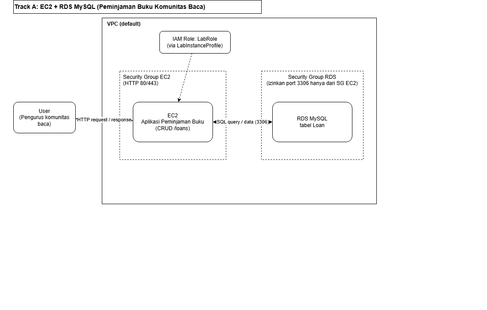
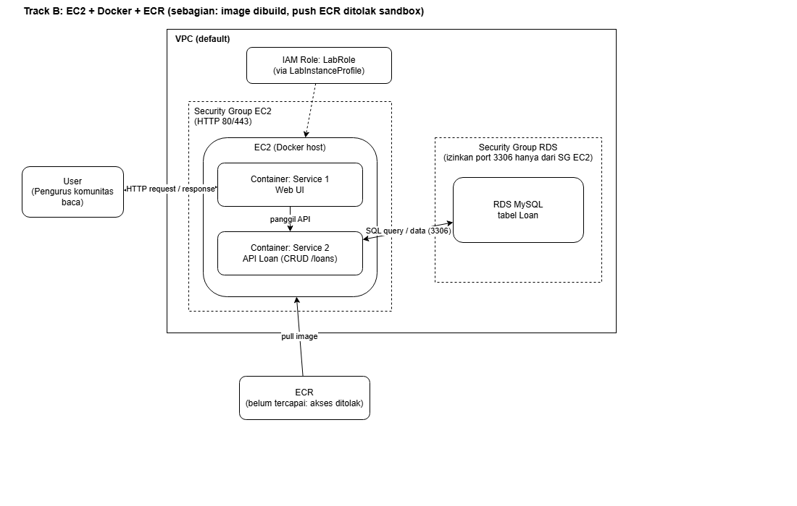

# Sistem Peminjaman Buku

Sistem peminjaman buku berbasis web untuk komunitas baca. Pengurus dapat mencatat peminjaman,
melihat daftar, mengubah data (misalnya menandai buku sudah dikembalikan), dan menghapus catatan.
Dikerjakan untuk tugas Cloud Computing (AWS Learner Lab), Track A: EC2 + RDS MySQL.

## Arsitektur
Pengurus mengakses aplikasi Flask yang berjalan di EC2 lewat HTTP. Flask menjalankan query ke RDS MySQL
yang berada di VPC yang sama, lalu hasilnya dikembalikan sebagai JSON. Security group membatasi akses:
EC2 menerima HTTP dari internet, sedangkan RDS hanya menerima port 3306 dari security group EC2.
### Track A: EC2 + RDS MySQL


### Track B: EC2 + Docker + ECR (sebagian)



## Tech stack
- **Flask (Python):** setiap kombinasi method dan path dipetakan ke satu fungsi, jadi keempat endpoint
  `/loans` langsung menjadi empat fungsi. Tanpa ORM atau admin bawaan, sehingga ringan untuk instance kecil.
  Konfigurasi dibaca dari environment variable, jadi kode yang sama bisa jalan di laptop dan di EC2.
- **MySQL di RDS:** entitas `Loan` berupa data terstruktur dengan tipe tetap, sehingga cocok untuk skema
  relasional. Backup dan patching ditangani AWS, dan data terpisah dari server aplikasi sehingga tetap
  aman bila instance EC2 diganti.
- **EC2:** memberi kendali penuh atas OS untuk memasang Python dan menjalankan aplikasi. Security group
  berfungsi sebagai firewall per-instance untuk membatasi port yang terbuka.

## Entitas dan endpoint
Entitas `Loan` disimpan di tabel `loans`:

| Field | Tipe | Keterangan |
|---|---|---|
| id | INT, auto increment | Primary key |
| judul_buku | VARCHAR(150) | Judul buku |
| peminjam | VARCHAR(100) | Nama peminjam |
| tanggal_pinjam | DATE | Format `YYYY-MM-DD` |
| status | VARCHAR(20) | `dipinjam` atau `dikembalikan` |

| Method | Endpoint | Fungsi |
|---|---|---|
| POST | `/loans` | Catat peminjaman baru |
| GET | `/loans` | Lihat semua peminjaman |
| PUT | `/loans/{id}` | Ubah data peminjaman (boleh sebagian field) |
| DELETE | `/loans/{id}` | Hapus catatan peminjaman |
| GET | `/health` | Cek aplikasi dan koneksi database |

## Struktur repo
- `app.py`: aplikasi Flask
- `schema.sql`: pembuatan database dan tabel
- `requirements.txt`: dependensi Python
- `.env.example`: contoh konfigurasi 
- `DEPLOYMENT.md`: langkah deployment ke AWS sesuai yang dikerjakan
- `Dockerfile`, `.dockerignore`: perluasan ke container (Track B, sebagian)
- `documents/`: architecture diagram (PDF dan PNG) serta design brief
- `evidences/`: screenshot bukti AWS (Track A dan Track B)

## Menjalankan
```bash
python3 -m venv venv && source venv/bin/activate
pip install -r requirements.txt
cp .env.example .env     
set -a && source .env && set +a
python3 app.py
```
Database dibuat lebih dulu dengan `schema.sql`. Langkah di AWS ada di `DEPLOYMENT.md`.

## Perluasan Docker (Track B, sebagian)
Aplikasi yang sama dibungkus menjadi image Docker (`Dockerfile`), dibuild, dan dijalankan sebagai container
di EC2 dengan koneksi ke RDS yang sama. Konfigurasi database tetap dikirim lewat environment variable, tidak
ditulis di image. Push ke ECR belum berhasil karena akses ditolak di lingkungan sandbox, rinciannya ada di
`DEPLOYMENT.md`.

## Dokumen
- [Architecture diagram](documents/architecture_peminjaman_buku_drawio.pdf): Track A dan Track B
- [Design brief](documents/DESIGN_BRIEF.pdf): use case, track, entitas, endpoint

## Bukti AWS
Screenshot ada di folder [`evidences/`](evidences/), dibagi per track:
[Track A](evidences/track-a/) dan [Track B](evidences/track-b/).
Isinya mencakup VPC dan security group, instance EC2 berjalan, RDS berstatus Available, koneksi
EC2 ke RDS, health check aplikasi, log aplikasi, container Track B, dan error ECR (akses ditolak sandbox).
